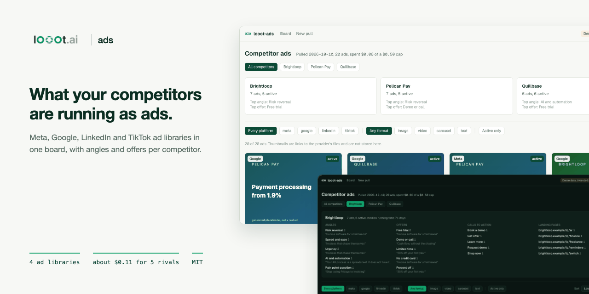
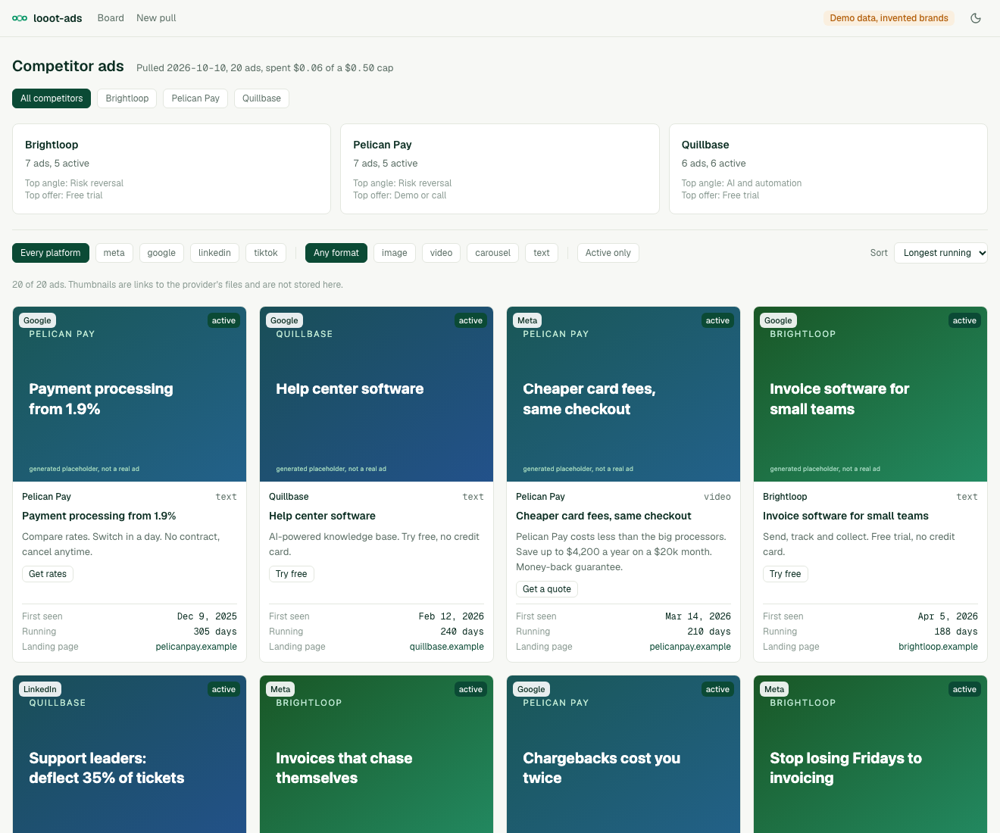
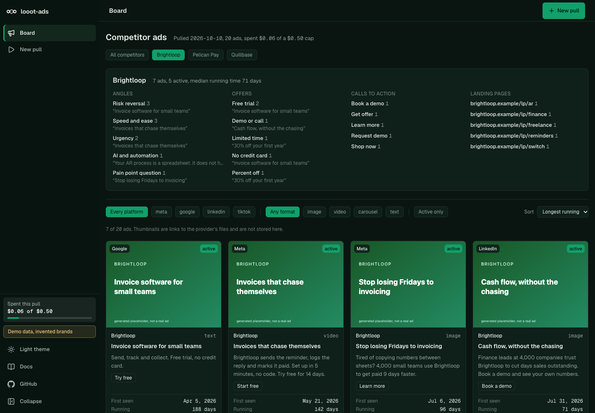
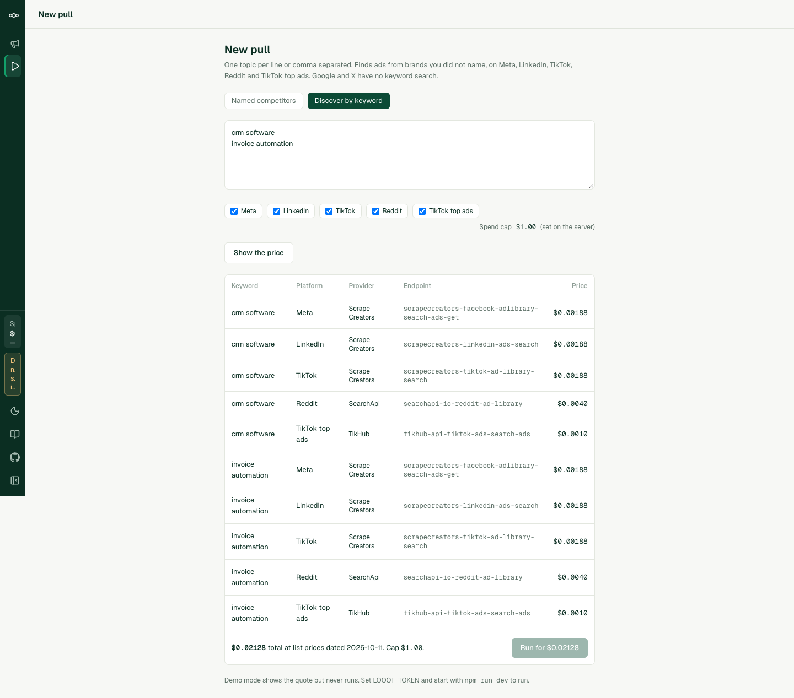

<p align="center"></p>

# looot-ads

[](LICENSE) [](https://github.com/loootai/looot-ads/releases) [](https://docs.looot.ai)

An open-source alternative to Foreplay, the competitor ad library and swipe-file tool. Foreplay starts at $49 a month billed annually ($59 monthly), read on its public pricing page on 2026-10-10. This repo pulls the same kind of data on demand through one looot key and charges per call. A pull of five competitors across four platforms is about $0.05 at list prices, and one keyword across five platforms is about $0.011.

Name competitors by domain or by name. looot-ads reads their ads from the Meta, Google Ads Transparency, LinkedIn and TikTok ad libraries, and from X when you give a handle. It shows a board of creatives with the copy, first seen date, running time, platform and landing page, and adds a summary of the angles and offers in each competitor's copy.

Or give it a keyword instead of a name. Discovery mode searches Meta, LinkedIn, TikTok, Reddit and the TikTok Creative Center top ads for a topic such as `crm software` and shows ads from brands you never named, with the advertiser on each card. That is the Foreplay-style discovery library, built from public ad libraries.

> **Catalog change.** The Adyntel endpoints that v0.1.4 and older used are no longer in the public looot catalog, so a pull with a live price check would have refused every Meta, Google and LinkedIn call for a domain. v0.1.5 reads Meta and LinkedIn by company name and Google by domain through endpoints that are listed today. A pull is also cheaper (see [Spending](#spending)).

> **Spend limits.** v0.1.6 adds a daily and monthly budget with reserve-then-settle and stored results, so repeating a request is not charged twice and parallel requests cannot pass the budget together. See [Spending](#spending).

> **Security notice.** Versions 0.1.3 and older had no admin sign-in. Anyone who could reach a deployed web UI could read the saved pull, and could start paid looot runs on your token with a spend cap they chose. If you run v0.1.3 or older on a reachable host, upgrade to v0.1.4 and set `ADS_ADMIN_PASSWORD`. See [Securing a deployment](#securing-a-deployment).





The demo data is invented. The brands (Brightloop, Pelican Pay, Quillbase) and the advertisers found by the demo keyword (Ledgerly, Tallybird, Penwise) do not exist, their domains end in `.example`, and every thumbnail is a generated placeholder labelled as one.

## What you need

- Node 22.12 or newer. `package.json` has no `engines` field. Next.js 16 needs 20.9 or newer and the test runner (vitest 5) needs 22.12 or newer. I ran everything below on Node 24.
- npm. Nothing else for the demo and for `--dry-run`.
- A looot account and an agent token, only for a real pull. Sign up at https://looot.ai/auth/sign-up. To get a token, run `npm i -g looot` and then `looot login`, which opens a browser approval. Or open the looot web app, go to Settings, "Agent tokens" and create one (https://docs.looot.ai/get-started/sign-in). With no browser, create the token there and `export LOOOT_TOKEN=...`.
- The token needs the scopes `runs.execute`, `catalog.read`, `runs.read` and `usage.read`.
- A funded balance. A run needs prepaid credit, the minimum top-up is $5, and signing up adds no credit (https://docs.looot.ai/money).

No other account is used. There is no Supabase and no user database. The web UI has one admin password that you set yourself (see [Securing a deployment](#securing-a-deployment)). The demo needs none.

## Try it in one minute

No account and no token.

```bash
git clone https://github.com/loootai/looot-ads.git
cd looot-ads
npm install --ignore-scripts
npm run demo
```

The web UI opens at http://localhost:3220 (`next dev -p 3220`) with invented brands. `/new` shows the quote page. In demo mode the run button makes no looot call. If port 3220 is busy, run `NEXT_PUBLIC_DEMO=1 npx next dev -p 3221`. For the same data as files, run `npm run ads -- --demo --out out`, which writes `out/ads.json`, `out/ads.csv` and `out/brief.md` and prints `Demo report written to out. 28 invented ads, no looot call.`

## Run it with your own data

Copy the example env file. The web UI (Next.js) reads `.env.local`. The CLI does not read any env file, so load it into your shell first.

```bash
cp .env.example .env.local     # then put your token in LOOOT_TOKEN
set -a; source .env.local; set +a
```

| Variable | Required | What it does | Where to get it |
| --- | --- | --- | --- |
| `LOOOT_TOKEN` | Yes for a real pull. Not needed for `--dry-run`, `--demo` or `npm run demo`. | The looot agent token. Server side only, never sent to the browser. | `looot login`, or Settings, "Agent tokens" in the looot web app |
| `LOOOT_API_URL` | Optional | looot API base URL. Default `https://api.looot.ai`. Also used when reading live prices. | Leave unset |
| `LOOOT_ADS_DATA_DIR` | Optional | Folder where the web UI saves the last pull as `latest.json`. Default `./.looot-data`. | Any folder you own |
| `ADS_ADMIN_PASSWORD` | Yes for the web UI outside the demo | Admin password, 12 characters or more. Without it every admin page and route stays closed and `/login` shows what to set. The CLI does not need it. | You choose it |
| `ADS_ADMIN_PASSWORD_HASH` | Optional | Replaces the plain password. Output of `npm run hash-password -- 'your password'`. Wins if both are set. | `npm run hash-password` |
| `ADS_SPEND_CAP_USD` | Optional | The web UI's spend cap per pull. Default 1.00, at most 100. Only the server sets it. | You choose it |
| `ADS_SESSION_SECRET` | Optional | Key that signs session cookies. Default: derived from the password, so a new password signs everyone out. | Any long random string |
| `ADS_COOKIE_SECURE` | Optional | Set to `0` only to test over plain http in production mode. | Leave unset |
| `NEXT_PUBLIC_DEMO` | Optional | `1` shows the invented demo data and blocks every looot call. `npm run demo` sets it for you. | Do not set it for real pulls |

Put your competitors in a CSV with a `name` and a `domain` column, one per line. `competitors.example.csv` in this repo has five invented ones (domains end in `.example`). A plain list of names or domains also works, or pass `--competitors "acme.com,Globex"`.

Price first. A dry run needs no token and makes no call. It uses the list prices dated 2026-10-11. This is the real output of `npm run ads -- --file competitors.example.csv --dry-run`:

```text
Plan

  Brightloop             Meta           scrapecreators-facebook-adlibrary-company-ads-get    $0.00188
  Brightloop             Google         searchapi-io-google-ads-transparency-center          $0.0040
  Brightloop             LinkedIn       scrapecreators-linkedin-ads-search                   $0.00188
  Brightloop             TikTok         scrapecreators-tiktok-ad-library-search              $0.00188
  (the same four lines for Pelican Pay, Quillbase, Northfield and Halcyon)

  20 calls, $0.0482 at list prices dated 2026-10-11. Spend cap $1.00.

Dry run: no looot call was made and nothing was written.
```

A name without a domain skips Google. `npm run ads -- --competitors "acme.com,Globex" --dry-run` prints `7 calls, $0.01528` and a line `Globex  Google  skipped: Google Ads Transparency Center needs a domain for Globex; add one to include it.`

Discovery by keyword. `npm run ads -- --keywords "crm software" --dry-run` prints:

```text
Plan

  crm software           Meta           scrapecreators-facebook-adlibrary-search-ads-get     $0.00188
  crm software           LinkedIn       scrapecreators-linkedin-ads-search                   $0.00188
  crm software           TikTok         scrapecreators-tiktok-ad-library-search             $0.00188
  crm software           Reddit         searchapi-io-reddit-ad-library                       $0.0040
  crm software           TikTok top ads tikhub-api-tiktok-ads-search-ads                     $0.0010

  5 calls, $0.01064 at list prices dated 2026-10-11. Spend cap $1.00.
```

Keywords and competitors can share one run (`--keywords` plus `--competitors`, or a `kw: crm software` line in the file). Each row uses its own default platforms. An X handle goes after the name, `"acme.com @acme"`, and adds one X call of up to 20 results (`--platforms` with `x` also asks for it).

Then the real pull, with a cap near the quoted total (the example domains are invented, so use your own competitors):

```bash
npm run ads -- --file competitors.csv --max-spend 0.25 --out out
```

Options: `--keywords <list>`, `--platforms meta,google,linkedin,tiktok,reddit,x,tiktoktop` (default: the original four per competitor, plus X when a handle is given, and the five keyword platforms per keyword), `--max-spend <usd>` (default 1.00), `--out <dir>` (default `out`), `--fresh <tag>` to pull again, `--demo` to write the demo report. Before it runs, the CLI reads live prices from the catalog and prints the plan again. Results go to `out/ads.json`, `out/ads.csv` and `out/brief.md`. `ads.json` lists every call under `runs`, each with its `runId`. Exit code 0 is done, 1 means a source failed or is pending, 2 is bad usage.

Web UI on the same engine. Set `ADS_ADMIN_PASSWORD` in `.env.local`, run `npm run dev`, open http://localhost:3000/new and sign in. Paste competitors (or switch to "Discover by keyword" and paste topics), press "Show the price", then "Run for $0.05". The price table names the platform, the provider, the endpoint and the price of each call. The server signs each quote. The run button works only with a quote the server signed for your session and for those competitors and platforms, and it expires after 10 minutes. If the live price rose above the quote, the server refuses with a 409 and asks you to quote again. The cap is `ADS_SPEND_CAP_USD`, not a field in the page. The last pull is saved to `.looot-data/latest.json` on your machine.



## Spending

looot shows the price before each paid action, and so does this repo. The CLI prints the plan first and the web UI shows a table and a total before the run button works. A pull of five competitors across four platforms is about $0.05 at list prices. One keyword across five platforms is about $0.011.

Four limits stand between a request and a charge, checked in this order: the quote, the cap per pull, the period budget, then the call.

- The quote is printed first. The cap per pull is `--max-spend` in the CLI, default $1.00, and `ADS_SPEND_CAP_USD` for the web UI (the page shows it and cannot change it). A cap in a request body is ignored. The web UI allows 6 paid runs per session per hour.
- The period budget caps all pulls together: a daily and a monthly amount (UTC), $10 and $50 until you change them. The owner changes them on the Costs page of the web UI, or sets the starting values with `LOOOT_ADS_DAILY_USD` and `LOOOT_ADS_MONTHLY_USD`. A request to `/api/run` cannot carry a budget: a request with a budget field is refused with 400. The CLI refuses a pull whose chargeable quote is above what is left, unless you pass `--partial`.
- Before each paid call the app reserves its list price in `budget.json` (in `LOOOT_ADS_DATA_DIR`, default `.looot-data`), under a lock file, and refuses the call if used plus reserved plus the price would pass the daily or the monthly budget. Two requests started together cannot both pass. When the call ends the reservation becomes the real charge. A call looot refused with an HTTP answer releases it. A call still running at looot (`pending`) keeps its reservation: it is never recorded as failed at $0 and the budget is never handed back early. Reserved money counts against the budget until the call ends.
- The next pull looks up every pending call with `GET /v1/runs/{id}` and settles the ones that ended, to their real cost. If looot cannot be reached, or the app died before it got a run id, the reservation stays for 24 hours and is then released.
- The sidebar and the Costs page show used, reserved and remaining for today and this month. At the budget the pull is refused with a message that names the limit.
- Every call has a stable key made from the endpoint and the normalised input. No date or time goes in. A finished call is stored in `budget.json` for 40 days. Repeating the same request is answered from the stored result: no call, no reservation, no charge, and the up-front budget check ignores it. If a stored result is missing, looot replays the same key without charging again.
- A fresh pull is always explicit. `--fresh <tag>` gives the call a new key, derived from the tag, and the tag is the only thing that changes it. The X ads call carries a date window, so its window ends at the first day of the current 7-day period (days counted from 1970-01-01, UTC). The input, and so the key, is the same on every day of the period, and the next period is a new request with its own stable key. X ads shown in the last few days of a period appear after the period ends, or with `--fresh`.
- The looot token balance is the final limit. Fund a dedicated token with only what you are willing to spend, and keep the budget below it.

The budget lives in a file, so run one instance on a disk that persists. Several instances, or a serverless host with a throwaway disk, do not share it.

Prices are the list prices in the public looot catalog on 2026-10-11. The CLI reads live prices before running and uses these only for `--dry-run` or when the catalog cannot be read.

| Platform | Needs | looot job | Provider | Endpoint | Price |
| --- | --- | --- | --- | --- | --- |
| Meta | name | `ads.meta.search` | Scrape Creators | `scrapecreators-facebook-adlibrary-company-ads-get` | $0.00188 per call |
| Meta | keyword | `ads.meta.search` | Scrape Creators | `scrapecreators-facebook-adlibrary-search-ads-get` | $0.00188 per call |
| Google | domain | `search.google-ads-transparency-center` | SearchApi | `searchapi-io-google-ads-transparency-center` | $0.004 per call |
| LinkedIn | name | `ads.linkedin.search` | Scrape Creators | `scrapecreators-linkedin-ads-search` | $0.00188 per call |
| LinkedIn | keyword | `ads.linkedin.search` | Scrape Creators | `scrapecreators-linkedin-ads-search` | $0.00188 per call |
| TikTok | name | `tiktok.ad-library.search` | Scrape Creators | `scrapecreators-tiktok-ad-library-search` | $0.00188 per call |
| TikTok | keyword | `tiktok.ad-library.search` | Scrape Creators | `scrapecreators-tiktok-ad-library-search` | $0.00188 per call |
| Reddit | keyword | `search.reddit-ad-library` | SearchApi | `searchapi-io-reddit-ad-library` | $0.004 per call |
| TikTok top ads (Creative Center) | keyword | `api.tiktok.ads.search-ads` | TikHub | `tikhub-api-tiktok-ads-search-ads` | $0.001 per call |
| X (EU and EEA ads) | handle | `api.twitter.ads.search` | Anysite | `anysite-api-twitter-ads-search` | $0.00036 per result, 20 results asked, $0.0072 per call |

The X endpoint is priced per result. The code asks for exactly 20, multiplies the live unit price by 20 for the quote, and never asks for more. The X ads repository only covers ads shown in the EU and EEA.

Typical cost, with the arithmetic:

- One competitor with a domain on Meta, Google, LinkedIn and TikTok: 3 x $0.00188 + $0.004 = $0.00964. Five competitors: $0.0482, as the dry run above shows. Before v0.1.5 the README said $0.0211 and $0.1057, priced on Adyntel endpoints that the catalog no longer lists.
- Add an X handle: $0.00964 + $0.0072 = $0.01684.
- One keyword on Meta, LinkedIn, TikTok, Reddit and TikTok top ads: 3 x $0.00188 + $0.004 + $0.001 = $0.01064.

Other ad-library endpoints exist in the catalog (SearchApi for Meta, LinkedIn and TikTok, HarvestAPI and Anysite for LinkedIn, Anysite and TikHub for TikTok, DataForSEO for Google). Swap one in by editing `src/lib/sources.ts`. Each endpoint is pinned with no provider fallback, so the quoted price is the price.

Rules the code enforces.

- The price of every call is shown before the call. The CLI prints the plan first. The web UI shows a table and a total.
- A per-run spend cap is enforced before each call. A call that would pass the cap, or the period budget, is not made and is marked "blocked".
- Each call has a stable idempotency key made from the endpoint and the input. Running the same input again is answered from the stored result and is not charged twice. `--fresh <tag>` changes the key when you want a new pull.
- A run still going when waiting stops is "pending", never "failed". It counts against the cap at its quoted price, and keeps its reservation in the period budget, until it settles.
- A failed run costs nothing, and the report says why.

## Deploy

Read [Securing a deployment](#securing-a-deployment) first and set `ADS_ADMIN_PASSWORD`. Without it the admin pages stay closed. This repo has no `vercel.json` and no GitHub workflow. The web UI saves the last pull to a local folder (`.looot-data`), which Vercel does not keep between requests and may not let you write, so run it on your own machine or a server with a disk. If you still import it into Vercel, set `LOOOT_TOKEN` as an environment variable but the saved board will not last. The CLI needs no deploy.

## Securing a deployment

Versions 0.1.3 and older had no admin authentication. From 0.1.4 every route is either public on purpose or admin, and the admin routes are closed unless you set a password.

### Route map

Pages and routes were listed from `src/app` and classified. A test reads the folder and fails if a route is missing from `src/lib/auth/routes.ts` or if an admin route does not call the gate.

| Class | Count | Routes |
| --- | --- | --- |
| Public by design | 4 routes | `/api/health`, `/login`, `/api/auth/login`, `/api/auth/logout` |
| Public static files | 2 | `/brand/*` (the logo), `/favicon.ico` |
| Admin pages | 3 | `/` (the board), `/new` (quote and run), `/costs` (budget and cost) |
| Admin API | 4 | `/api/quote` (reads the live catalog), `/api/run` (paid looot run), `/api/budget` (read, and change the period budget), `/placeholder/[name]` (demo creative images) |

There are no server actions, no webhooks and no export routes. Any path not listed is treated as admin. The CLI (`npm run ads`) runs on your machine with your own token and does not go through the web gate.

### How the gate works

- `src/proxy.ts` checks every request. Each admin page, the root layout and each admin route handler checks again with the same function, so a path the matcher misses is still closed.
- Not set up (no password, and not a clean demo): admin routes answer 503, admin pages redirect to `/login`, which says what to set. Nothing stored is rendered.
- Set up: a valid session is required. Page requests without one redirect to `/login`. API requests get 401.
- Sign-in: constant-time password comparison. A session is a signed token in an httpOnly, SameSite=Lax cookie, Secure in production, valid for 8 hours. 5 wrong passwords from one address lock that address for 15 minutes. 40 wrong passwords from anywhere lock sign-in for everyone for 15 minutes (a brute-force guard that also lets an attacker delay you, so use a long password and an IP allow-list too).
- State-changing admin requests need a same-origin `Origin` header and the per-session token in `x-ads-csrf`. The layout puts the token in a meta tag and the app's own fetch calls send it.
- Admin responses carry `Cache-Control: no-store`. All responses carry a Content-Security-Policy (`frame-ancestors 'none'`), `X-Frame-Options: DENY`, `X-Content-Type-Options: nosniff` and `Referrer-Policy: no-referrer`. The CSP allows inline scripts because Next.js needs them, and https images and video because ad thumbnails load from the ad libraries' own links.
- The password and token never reach the client bundle. The server reads them at runtime.

### Money

- The spend cap comes from `ADS_SPEND_CAP_USD` on the server (default 1.00, at most 100). `/api/quote` and `/api/run` ignore any cap in the request body.
- The period budget (`PUT /api/budget`) is changed only by the signed-in owner, with the CSRF token. A run request cannot raise it, and one that carries a budget field is refused. See [Spending](#spending). The budget file needs one instance on a persistent disk. The looot token balance is the final limit, so give the app a token funded with only what you are willing to spend.
- `/api/quote` returns a quote token signed for your session, for those competitors and platforms, and for that total, valid for 10 minutes. `/api/run` refuses without a valid token, and refuses when the live price is above the signed total.
- `/api/run` allows 6 runs per session per hour, `/api/quote` 60 per 10 minutes. The limits sit in memory in one process. Behind several instances, rate limit at the proxy too.
- The demo never calls looot. It starts only where no `LOOOT_TOKEN` and no saved pull exist, unless you also set a password.
- The address for sign-in lockout comes from `x-forwarded-for`, so run the app behind a proxy that sets it and strips what clients send.

### Setup

```bash
export ADS_ADMIN_PASSWORD='a password of 12 or more characters'
# or keep it out of the environment as plain text:
npm run hash-password -- 'a password of 12 or more characters'   # prints ADS_ADMIN_PASSWORD_HASH=...
```

Rotate the password by changing the variable and restarting. Changing it signs every session out. The last pull is saved to `.looot-data/latest.json` (or `LOOOT_ADS_DATA_DIR`), a plain file on the server's disk. Protect and back it up like any file you do not want shared.

### The stronger option

A shared password is the floor. For anything people other than you can reach, put the admin paths behind a VPN, a private network or an identity-aware proxy (Cloudflare Access, Tailscale, Google IAP, oauth2-proxy) and keep only the public routes in the table above open to the internet. Keep the app's password on as well.

### Not covered

No per-user accounts, no roles, no audit of who signed in, and no Supabase option. The app has one admin.

## How the summary is made

Angles and offers come from keyword and pattern rules in `config/angles.json`, not from a model. An ad counts toward "Risk reversal" if its headline or body contains a word like "guarantee" or "cancel anytime". Edit the file to fit your market. The summary also lists the longest-running ads, the median running time, the most used calls to action and the landing pages the ads point to. Running time is the days between the library's start date and its end date, or today for an ad still active.

## What it does not do

- It does not store creatives. It keeps the thumbnail and video links the provider returns, plus short text. The board loads thumbnails from the provider's link. Links can expire.
- It makes one call per competitor and platform, which returns the first page the provider gives. It does not page through every ad of a large advertiser.
- Foreplay also offers creative analytics on your own ad account, AI briefs and a hosted swipe file. None of that is here. The catalog searches that found no provider are listed below.
- Google needs a domain. A name alone skips Google and says so in the report. Google has no keyword search in the catalog: the Google keyword endpoint (`dataforseo-google-ads-search-advanced`, job `ads.google.search`) takes a target domain or advertiser ids, not a keyword.
- X needs the advertiser's handle and has no keyword search. It shows only ads delivered in the EU and EEA.
- Reddit and TikTok top ads are keyword searches. A named competitor is not sent to them, because their search is free text and would return unrelated brands.
- A keyword search is a free-text search of each library. It returns whatever the library ranks first, one page per call, so treat the advertisers as leads, not as a complete list.

### Searched in the catalog and not found

On 2026-10-11 these searches of the public catalog (`/v1/public-catalog?q=`) found no provider for the dropped features: "ads analytics account", "ad creative", "swipe file", "ad spy", "top ads", "competitor ads". The only account-level analytics endpoints returned were Google Analytics admin calls and Douyin or WeChat account lists, which are not ad accounts. Creative storage and AI briefs are not data endpoints. Page-id lookups for Meta (`searchapi-io-meta-ad-library-page-search`, `scrapecreators-facebook-adlibrary-search-companies`) exist but are not needed, because the company-ads endpoint takes a company name.

## Troubleshooting

| What you see | Cause and fix |
| --- | --- |
| `LOOOT_TOKEN is not set. Create an agent token at https://looot.ai/settings, or use --dry-run or --demo.` | The CLI found no token. Run `set -a; source .env.local; set +a` or `export LOOOT_TOKEN=...`. The token page is Settings, "Agent tokens" in the looot web app. Exit code 2. |
| `LOOOT_TOKEN is not set on the server.` (HTTP 501 from the web UI) | Put `LOOOT_TOKEN` in `.env.local` and restart `npm run dev`. |
| `Demo mode makes no looot call.` (HTTP 403) | You started with `npm run demo` or `NEXT_PUBLIC_DEMO=1`. Use `npm run dev`. |
| A source shows `failed` with a message and a code in brackets, such as `... (code)` | The message and code come from the looot API. A 401 means the token is wrong, revoked or lacks a scope (it needs `runs.execute`, `catalog.read`, `runs.read`, `usage.read`). A balance error means the account has no credit, so top up at https://docs.looot.ai/money. Failed calls cost nothing. |
| `Spend cap reached (... of ...). This call would cost more than the cap allows.` | The call was marked "blocked" and not made. Raise `--max-spend` if you accept the price. |
| `The live price could not be read, so the call was not made.` | The catalog price for that endpoint could not be read. Try again, or check `LOOOT_API_URL`. |
| `Still queued when waiting stopped. Not failed. Run the same command again to read it; the stored run is replayed and not charged twice.` (the status word can differ) | The run is pending. Run the same command again. |
| `The run ended as blocked. Nothing was charged.` (or `stopped`) | The run ended without a result. Read the run in the looot web app. |
| `The library returned no ads for this input.` | The call worked but the parser found no ads. Either the advertiser has none, or the response has a shape the parser does not know. See Status below. |
| `The price changed since you confirmed it. Quote again.` (HTTP 409) | The live price rose after you confirmed. Press "Show the price" again. |
| `Spend cap must be a positive dollar amount, got "..."` | Pass a number above zero, such as `--max-spend 0.25`. |

How to file an issue. Open an issue at https://github.com/loootai/looot-ads/issues with the run id (from `runs` in `out/ads.json`), the command you used, and the raw response body with secrets removed.

## Status

No paid looot run was made while building this. The code that turns a provider response into ads is built from the endpoint descriptions in the catalog, from the field names those providers document, and from fixtures written to match (`src/lib/fixtures/`, all invented). The catalog lists no response fields for the endpoints added in v0.1.5, so those parsers (Meta keyword search, Google Ads Transparency, Reddit, X and TikTok top ads) are unverified, tolerant guesses, the same as the original four. It reads many alias names for each field and skips what it cannot read, but the first real pull may show a field it misses. If a provider returns ads that look empty, open an issue with the raw response (see Troubleshooting), and add the alias in `src/lib/normalize.ts`. The unit tests mock HTTP.

## Develop

```bash
npm test            # vitest, mocked HTTP
npm run typecheck
npm run lint
npm run build
npm run leak-scan   # run before every push; git config core.hooksPath .githooks turns it on
```

Stack: TypeScript, Next.js App Router, Tailwind. Versions are pinned exactly and install scripts are off (`.npmrc`).

## Install for agents

Read `llms.txt`, then use the Claude Code skill in `skills/looot-ads/SKILL.md`. To add it to a project:

```bash
mkdir -p .claude/skills && cp -r skills/looot-ads .claude/skills/
```

The skill runs `--dry-run` first, shows the total, and runs only after you agree.

## Licence

MIT, copyright looot. Foreplay is a trademark of its owner. This project is not affiliated with it and uses none of its code, text or images.

## Related

Other open-source projects built on [looot](https://looot.ai):

- [looot-intent](https://github.com/loootai/looot-intent): account intent and buying-stage scoring (6sense)
- [looot-score](https://github.com/loootai/looot-score): lead and ICP fit scoring (MadKudu)
- [looot-reveal](https://github.com/loootai/looot-reveal): which companies visit your site (RB2B, Clearbit Reveal)
- [looot-techstack](https://github.com/loootai/looot-techstack): website technologies from several providers (BuiltWith, Wappalyzer)
- [looot-signals](https://github.com/loootai/looot-signals): hiring, funding and news triggers (TheirStack, Harmonic)
- [looot-lookalike](https://github.com/loootai/looot-lookalike): lookalike company search (Ocean.io)
- [looot-reviews](https://github.com/loootai/looot-reviews): review themes and weak spots (ReviewTrackers)
- [looot-battlecards](https://github.com/loootai/looot-battlecards): competitor battlecards (Klue, Crayon)
- [looot-mentions](https://github.com/loootai/looot-mentions): brand and keyword listening (Brand24)
- [looot-warm-leads](https://github.com/loootai/looot-warm-leads): warm leads from LinkedIn intent signals (Gojiberry)
- [looot-crm](https://github.com/loootai/looot-crm): a small CRM with buying signals built in
- [looot-seo](https://github.com/loootai/looot-seo): self-hosted SEO workspace
- [looot-monitor](https://github.com/loootai/looot-monitor): brand and competitor monitoring with alerts
